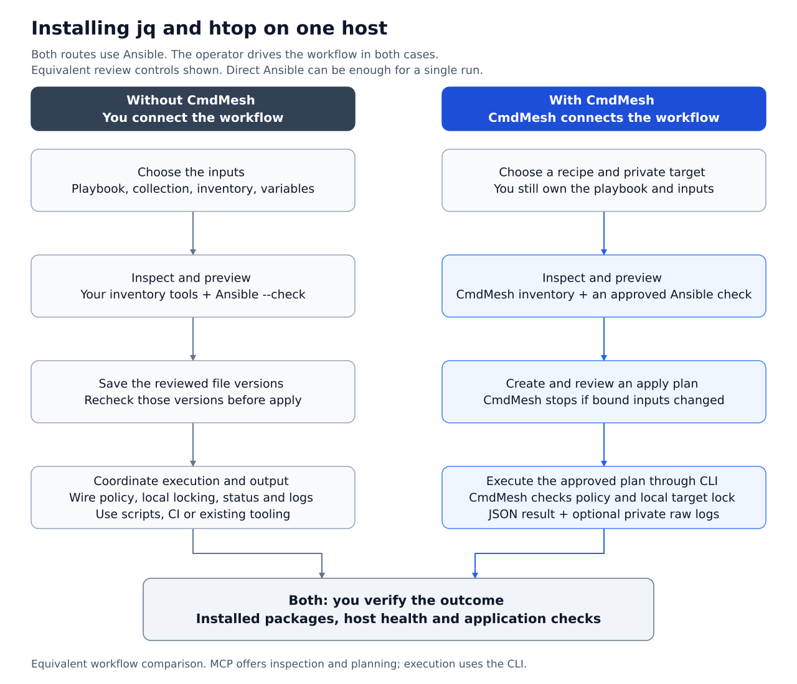

# What you would do without CmdMesh

Consider one operation: install `jq` and `htop` on a selected Proxmox host.
Both approaches use Ansible to inspect and install packages. The difference is
how you select inputs, connect review to execution, and retain results.

## Run Ansible directly

You can already share a playbook, keep inventory and credentials private, and
run checks with Ansible. CmdMesh is not required for any of those capabilities.

With the [Proxmox setup](proxmox.md) prepared, a trusted controller installed at
`.generated/ansible`, and reviewed private inputs, a direct check has this form
from the core repository root:

```bash
ANSIBLE_COLLECTIONS_PATH="$PWD/../cmdmesh-proxmox/ansible" \
  .generated/ansible/bin/ansible-playbook \
  -i ../private/ansible/inventory.yml \
  ../cmdmesh-recipes/recipes/proxmox-host-baseline/playbook.yml \
  --limit node-a -e @../private/ansible/vars.yml --check
```

This can connect to the selected host. Review the playbook, selected host, and
package/removal lists before running it. Check mode is not a sandbox.

You inspect the check output. For an approved apply of this particular recipe,
you remove `--check` and explicitly supply `cmdmesh_allow_changes=true` as an
extra variable. You then inspect the package versions, existing guests, and
services. The [recipe's verification and recovery instructions](https://github.com/luis-lobo-ar/cmdmesh-recipes/blob/2ac36649ba54dc2f366be18565d6c7313978a7ce/recipes/proxmox-host-baseline/README.md)
still apply.

That direct path is enough if all you need is to run a reviewed playbook.

## Add the same review and execution workflow

For recurring operations, you may also want a standard way to discover
procedures, prove which inputs were reviewed, refuse stale plans, control
execution, and record a result. Without CmdMesh, you assemble that workflow
using existing tools, CI, or your own scripts. CmdMesh implements those shared
parts for its supported operations.



| Work | Without CmdMesh | With CmdMesh |
| --- | --- | --- |
| Supply the playbook, inventory, variables, and credentials | You prepare them | You still prepare them; a recipe names the procedure and an environment names private inputs |
| Inspect infrastructure | Use your API clients, scripts, or existing inventory tools | Call a configured provider through `inventory pull` for the core's JSON snapshot format |
| Preview package changes | Run Ansible `--check` | Run Ansible `--check` through an approved check plan; static planning alone is not a preview |
| Connect review to exact file versions | Record the reviewed inputs and arrange a check before execution | The plan binds supported inputs and commands; execution regenerates the plan and refuses a mismatch |
| Control and report execution | Use Ansible's status/output and add your own policy, locking, or report storage where needed | The CLI checks configured policy, holds a local target lock, and returns JSON status; raw logs require `--log-dir` |
| Give an AI client access | Use its terminal capability or an existing adapter | Use CmdMesh's inventory/planning MCP tools; approved execution remains a CLI operation |
| Verify and recover | Check the host and application; follow your recovery procedure | You still do those checks and follow the recipe's recovery instructions |

That comparison describes the host-baseline Recipe1 example. The first bounded
[memory procedure](verified-procedures.md) also collects live preflight and
postconditions automatically, records native mutation uncertainty separately
from Ansible completion and prevents replay of a consumed intent. Application
health and recovery remain separate qualification.

The diagram compares equivalent workflows. It does not mean you must build a
custom system before using Ansible. If your existing automation already provides
these checks, you can keep using it. CmdMesh offers a common implementation that
another environment can reuse.

## What changes in practice

Suppose an inventory or variables file changes after you review a CmdMesh plan.
Execution rejects the changed bound input before starting Ansible. You make and
review a new plan. A direct `ansible-playbook` command ordinarily reads the files
present when it runs; an equivalent review/version check needs separate tooling.

An apply needs its own freshly reviewed apply plan, even after a successful
check. Review identifies the selected commands and bound files; the plan does
not predict the live host's eventual state. Follow the
[host-baseline walkthrough](../README.md#plan-a-real-host-baseline).

Two administrators can use the same recipe with different private inventories
and package selections. Each creates and reviews a separate plan. The shared
recipe describes the procedure; private inputs describe where and how to use it.

## What stays your responsibility

You select trustworthy playbooks and tools, manage credentials, choose targets,
approve changes, and verify actual outcomes. Raw logs can contain secrets. A
successful local process is not proof of application availability or recovery.

CmdMesh does not turn inventory drift into automatic remediation. The Proxmox
API inventory does not inspect installed Debian packages; Ansible performs that
package check. Local target locks do not coordinate different controllers.
Terraform execution and state remain separate. See the
[execution reference](execution.md) for the exact bindings and limits.

## Edit the diagram

Open [the editable draw.io source](images/with-and-without-cmdmesh.drawio) in
draw.io. The SVG and PNG are viewable renderings of that source. After editing,
export both formats and update the renderings. The current renderings do not
embed the draw.io XML; use the separate source file for edits.
